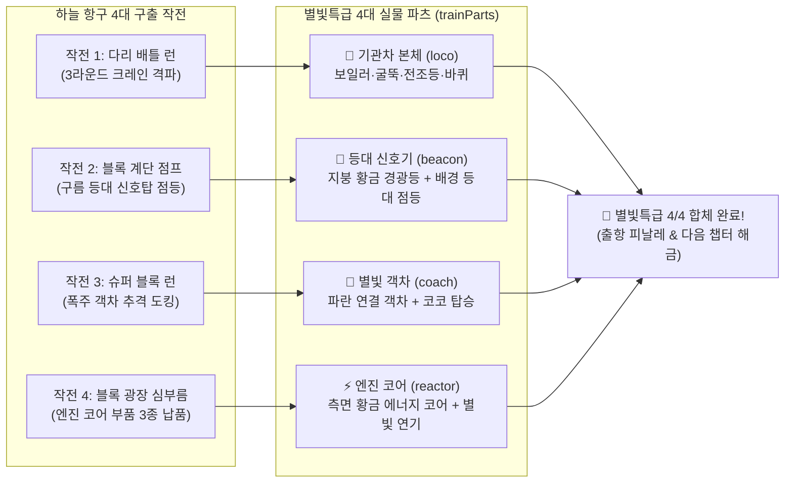
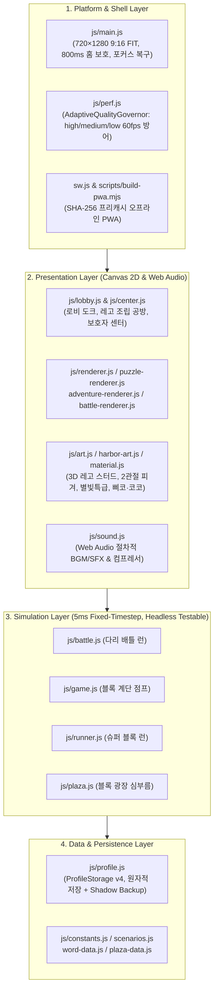

# 블록 점프 월드: 별빛특급 구출 작전 — 마스터 설계 및 개발 계획서 (`PLAN.md`)

> **문서 성격**: 본 문서는 과거에 누적된 100KB 분량의 중복 회의록·모순된 수식·임시 검증 로그를 전면 폐기하고, **실제 게임 개발 파이프라인(Core Pillar → World & Meta Loop → Level & System Spec → 4-Layer Tech Architecture → Production Roadmap)** 기준에 맞춰 **처음부터 다시 작성한 단일 진실 공급원(Single Source of Truth)** 입니다.

---

## 0. 전면 재설계 핵심 요약 — 지울 것 / 수정할 것 / 새로 만들 것

개발의 모든 단계에서 **"항상 고민해: 이게 맞나? 더 나은 건 없나?"(Doubt-Driven Development)** 원칙을 적용하여, 아이에게 숙제처럼 느껴지거나 게임의 몰입을 깨는 요소를 지우고 진짜 게임의 재미(재미 80% : 인지 부스터 20%)로 재설계합니다.

### A. 인게임 시스템 및 콘텐츠 정리

| 구분 | 대상 모드 / 시스템 | 기존 문제점 ("이게 맞나?") | 처리 방침 (지울 것 / 수정할 것 / 새로 만들 것) | 상태 |
| :--- | :--- | :--- | :--- | :--- |
| **🗑️ 지울 것** | **로비 & 완료 판정** | 배틀 3라운드만 깨도 다른 3개 작전이 남았는데 `별빛특급 합체 완료`가 표시되고, 계단 브레이크 1회만 성공해도 등대 작전이 완료 처리됨 | 가짜 완료 판정 즉시 폐기. **4대 작전 각각의 고유 목표를 모두 달성해야만 4파츠가 조립되고 최종 합체 완료가 선언**되도록 정리 | **코드 반영 완료** |
| **🗑️ 지울 것** | **러너 & 광장 색상 스포일러** | 러너에서 정답 단어 블록만 금색(`#ffd95e`)으로 빛나고, 광장에서 정답 아이템 바닥만 초록색으로 표시되어 글자·기억을 안 보고 색깔만 보고 찍게 됨 | 정답/오답 블록의 외형·바닥 색상 차이를 완전히 폐기. 러너는 동일 색상 호버 드론으로, 광장은 거리 `< 1.25` 접근 시에만 이름표가 보이도록 정리 | **코드 반영 완료** |
| **🗑️ 지울 것** | **계단 점프: 학교 도덕 문답** | 하늘 항구 구름 등대를 오르다가 갑자기 50층에서 '선생님 말씀 경청', '쉬는 시간 종소리', '우산 양보' 같은 학교 시험지가 튀어나와 몰입을 파괴함 | 학교·교실 배경의 훈계형 문답(`teacher`, `bell`, `rain`, `friend`)을 전면 폐기하고 **등대 수리·항구 현장 판단 이벤트**로 교체 | **Phase 3 개편** |
| **🗑️ 지울 것** | **슈퍼 블록 런: 상시 3칸 받아쓰기 족쇄** | 액션 러너 게임인데 `누가/무엇을/어쨌다` 단어 3개를 순서대로 맞히지 못하면 영원히 부스터(황금 질주)가 발동하지 않아 국어 숙제처럼 느껴짐 | '3단어 문장 완성 = 유일한 황금 질주 조건' 공식을 폐기. **점프·코인 아치 액션만으로도 황금 질주가 충전**되도록 분리 | **Phase 3 개편** |
| **🗑️ 지울 것** | **광장 심부름: 1회 오수거 즉시 전체 리셋** | 부품 2개를 잘 모았어도 실수로 다른 물건을 한 번 건드리면 즉시 실패(`retry`)로 처음부터 다시 해야 하며, 만화책·게임기를 무조건 '나쁜 함정'으로 고정함 | 1회 실수 전체 리셋(`retry`) 및 고정 도덕률을 폐기. **가방 내려놓기/교체 및 부분 납품** 구조로 전환 | **Phase 3 개편** |
| **🔧 수정할 것** | **캐릭터 관절 & 로비 도크 레이아웃** | 팔다리가 통짜 막대처럼 회전해 움직임이 뻣뻣하고, 로비에 구출한 기차가 길어지면 중앙 텍스트와 세 번째 메달을 가림 | **2관절(무릎·팔꿈치) 굴곡, 비대칭 보폭, 속도 피치, 착지 스쿼시**로 모션 개편. 로비는 **좌(아바타) / 중(작전 현황) / 우(기차 도크 클리핑 베이)** 3구역으로 완전 분리 | **코드 반영 완료** |
| **🔧 수정할 것** | **작전 1: 다리 배틀 런** | 좌우 숫자 게이트 통과와 보스 자동 사격만 반복되어 전략성이 얕음 | 3종 레고 보스(`1-1 철통 집게`, `1-2 쌍둥이 자석`, `1-3 항구 수호 거인`)의 **잠금 볼트(`🔩`) 파괴 기믹 시각화** 완료 + Phase 3에서 **교량 선로 레버 및 집게 예고 회피** 추가 | **1차 완료 / Phase 3 확장** |
| **🔧 수정할 것** | **작전 2: 블록 계단 점프** | 50층 다리 이후 끝이 없는 무한 등반 구조라 스테이지 클리어 성취감이 약함 | **80층 구름 등대 꼭대기 완주형 스테이지**로 개편. 25층·50층·75층 갈라진 판자 다리에서 현장 단서(풍향계·크레인 신호·전선)를 보고 건너며, 틀려도 즉사 대신 판자 흔들림 후 재도약 | **Phase 3 개편** |
| **🔧 수정할 것** | **작전 3: 슈퍼 블록 런** | 60초 동안 평지만 달리는 타이머 생존 구조라 '폭주 객차를 추격해 잡는다'는 서사와 따로 놂 | **폭주 객차 추격 거리(`240m → 0m`) 도킹 완주 구조**로 개편. 코인 아치 액션으로 가속하고, 지붕 갈림길에서 코코의 짧은 행동 단서(`점프!` / `숙여!` / `당겨!`) 선택 시 대량 추격 보너스 획득 | **Phase 3 개편** |
| **🔧 수정할 것** | **작전 4: 블록 광장 심부름** | 맵에 정답 3개만 딱 떨어지게 놓여 있어 탐색 자유도가 낮고 실수 만회가 불가능함 | **여분 부품 배치(동일 부품 2개 중 택1)** + **가방 3칸 슬롯 교체(실수로 집은 물건 내려놓기)** + **엔진 도크 부분 납품(맞는 부품만 먼저 장착)** 으로 개편 | **Phase 3 개편** |
| **✨ 새로 만들 것** | **별빛특급 4파츠 월드 연동** | 다른 모드를 깨도 내 기차나 다른 모드 배경이 달라지지 않아 이야기를 체감하기 어려웠음 | `기관차(배틀)` + `등대 신호기(계단)` + `별빛 객차(러너)` + `엔진 코어(광장)` 획득 시 **로비 도크 기차 실시간 조립** 및 **배틀·러너 배경의 구름 등대 서치라이트 점등 연동** | **코드 반영 완료** |
| **✨ 새로 만들 것** | **작전 중 체크포인트(`activeRun`) & 연령 6축 설정** | 게임 도중 브라우저가 닫히면 해당 판 진행도가 날아가며, 7세와 11세에게 동일한 속도·문항이 제공됨 | `Profile v4` 내 **`activeRun` 스냅샷 자동 복구(L0-B/C)** 및 보호자 센터 **연령 프리셋(`7~8세` / `9~10세` / `11세`) 6축 밸런스** 신설 | **Phase 4 신설** |

### B. 문서 및 저장소 파일 정리

1. **🗑️ 삭제 완료한 레거시 문서 (일회성 검증 스냅샷 7개 파일)**:
   - `docs/PHASE1_VALIDATION.md`, `docs/ARCADE_VALIDATION.md`, `docs/HARBOR_VALIDATION.md`, `docs/HARBOR_2026_11_25.md`, `docs/PRODUCTION_VALIDATION.md`, `docs/POLISH_VALIDATION.md`, `docs/POLISH_2026_11_25.md`
   - *삭제 이유*: Git 커밋 히스토리 및 GitHub Actions CI 로그와 중복되는 일회성 작업 메모가 누적되어 문서 용량(315KB)이 실제 게임 코드(220KB)보다 커지고 과거 수식과 현재 코드 간의 모순을 유발함.
2. **🔧 전면 재작성한 핵심 문서 (4대 문서 체계)**:
   - [`PLAN.md`](file:///C:/Users/woojupapa/.gemini/antigravity/scratch/woojugame/PLAN.md): 제품 철학, 스토리·메타루프, 4대 작전 설계 명세, 4계층 기술 아키텍처, 단계별 개발 계획서 (본 문서)
   - [`CLAUDE.md`](file:///C:/Users/woojupapa/.gemini/antigravity/scratch/woojugame/CLAUDE.md): 엔지니어링 헌장, 모듈 책임 경계, 성능·안전 가드레일, 빌드·검증 명령 규칙
   - [`README.md`](file:///C:/Users/woojupapa/.gemini/antigravity/scratch/woojugame/README.md): 프로젝트 개요, 별빛특급 4대 작전 루프, 기술 스택, 로컬 실행 및 테스트 가이드
   - 보조 상세 명세서 3종:
     - [`docs/STORY.md`](file:///C:/Users/woojupapa/.gemini/antigravity/scratch/woojugame/docs/STORY.md): 브릭 월드 세계관, 등장인물 4인방, 4챕터 12사건 시나리오 및 대사 톤앤매너 바이블
     - [`docs/AGE_DESIGN.md`](file:///C:/Users/woojupapa/.gemini/antigravity/scratch/woojugame/docs/AGE_DESIGN.md): 7~11세 연령대별 인지·조작 특성 및 6축 난이도 밸런스 매트릭스
     - [`docs/LONG_TERM.md`](file:///C:/Users/woojupapa/.gemini/antigravity/scratch/woojugame/docs/LONG_TERM.md): 저장 안전성(`L0-A/B/C`) 복구 명세 및 챕터 2~4 데이터 드리븐 월드 확장 설계

---

## 1. 핵심 철학 및 제품 정의 (Core Pillar)

### 1.1 한 줄 정의
> **"레고 브릭 장난감을 직접 조립하고 조종해 악당 크레인에게 붙잡힌 '별빛특급' 기차의 4대 부품을 하나씩 되찾아 합체시키는 9:16 모바일 아케이드 액션 어드벤처"**

### 1.2 황금 비율: 게임의 재미 80% : 인지 부스터 20%
아이가 스스로 게임을 찾고 계속 플레이하게 만드는 힘은 **조작의 손맛(점프·회피·사격), 시각적 조립 성취감(내가 구한 부품이 실제로 기차에 끼워짐), 스토리의 맥락(내가 왜 등대에 올라가고 객차를 쫓아가는가)** 에서 나옵니다.

- **절대 금기 4원칙**:
  1. **교육·치료·훈계 용어 노출 금지**: 화면·코드·대사 어디에도 `'교육'`, `'훈련'`, `'집중력'`, `'치료'`, `'학습'`, `'선생님 말씀'` 같은 단어를 노출하지 않는다.
  2. **흐름 차단형 시험지 금지**: 신나게 달리거나 오르는 도중 화면을 멈추고 학교 시험지 같은 3지선다 팝업을 강요하지 않는다. 모든 선택은 **인게임 지형·장치·단서** 안에서 이루어져야 한다.
  3. **색상 스포일러 금지**: 정답 오브젝트만 금색이나 초록색으로 칠해 아이가 단서를 읽거나 기억하지 않고 색깔만 보고 누르게 만드는 반칙을 금지한다.
  4. **단판 실수 전체 리셋 금지**: 한 번 잘못 집거나 한 번 잘못 밟았다고 지금까지 모은 진행도를 0으로 초기화하지 않는다. 실수는 즉각적인 물리 피드백(살짝 흔들림, 가방 교체)으로 알려주고 바로 만회할 기회를 준다.

---

## 2. 스토리·세계관 및 메타 루프 설계 (World & Meta Loop)

### 2.1 배경 및 발단: 하늘 항구(Sky Harbor)와 별빛특급
- **배경**: 모든 지형과 기계가 반짝이는 원통형 스터드(돌기) 브릭으로 조립된 **하늘 항구(Sky Harbor)**.
- **사건**: 밤하늘에 별빛을 실어 나르던 **별빛특급(Starlight Express)** 이 악당 집게 대장 **볼트(Bolt)** 의 거대 크레인에 붙잡혀 **4개 핵심 파츠**로 뿔뿔이 흩어졌다!
  1. **기관차 본체 (`loco`)**: 다리 위 3대의 거대 집게 크레인에게 붙잡힘 → **작전 1: 다리 배틀 런**
  2. **구름 등대 신호기 (`beacon`)**: 항구 안개 속에 등대 불이 꺼져 기차 길이 막힘 → **작전 2: 블록 계단 점프**
  3. **별빛 객차 (`coach`)**: 연결핀이 빠진 객차가 꼬마 공룡 코코를 태운 채 선로를 폭주함 → **작전 3: 슈퍼 블록 런**
  4. **엔진 코어 (`reactor`)**: 기관실에 넣을 핵심 조립 부품 3개가 항구 광장에 흩어짐 → **작전 4: 블록 광장 심부름**

### 2.2 등장인물 4인방 (인게임 역할 고정)
- **출동 대장 (플레이어 미니피겨)**: 노란 C자 집게손과 머리 스터드를 가진 레고 피겨. 공방에서 모자·망토·날개·제트팩과 무기(새총·물총·버블건·불꽃 완드)를 자유롭게 조립한다.
- **삐코 (Pico — 안내 로봇)**: 안테나와 화면 얼굴을 가진 파란 레고 보조 로봇. 로비 브리핑, 배틀 무전, 등대 다리 단서, 광장 부품 도면을 안내한다.
- **코코 (Coco — 꼬마 공룡 기관사)**: 기관사 모자를 쓴 초록 레고 공룡. 폭주하는 객차 위에서 단서를 외치고, 광장 기차 도크에서 부품을 받아 엔진을 조립한다.
- **볼트 & 루프 (Bolt & Loop — 악당 보스)**: 별빛특급을 붙잡은 집게 크레인 대장 볼트(챕터 1·2)와 엉킴 정글·별빛 역의 루프(챕터 3·4).

### 2.3 별빛특급 4파츠 실물 합체 루프 (`trainParts`)
아이가 어느 작전을 먼저 플레이하든 **내가 클리어한 작전의 부품이 즉시 로비 도크와 다른 작전 배경에 실물로 반영**됩니다.

- **엄격한 완료 판정 규칙 (`js/harbor-art.js` `trainParts`)**:
  - `loco`: `battle.roundClears >= 1` (기관차 탈환), `wagons`: `min(3, battle.roundClears)`
  - `beacon`: `stairs.cleared >= 1` (단순 10층 브레이크 성공이 아니라 등대 다리 조립/점등 완주 시에만 인정)
  - `coach`: `runner.cleared >= 1` (폭주 객차 도킹 성공 시에만 인정)
  - `reactor`: `plaza.cleared >= 1` (엔진 부품 3종 납품 완료 시에만 인정)
  - `complete`: **`loco && beacon && coach && reactor && battle.roundClears >= 3`** (4개 작전 완료 + 배틀 3라운드 모두 격파해야만 최종 합체 완료!)
  - **부분 조립 시각화**: 아직 배틀(`loco`)을 깨지 않고 등대(`beacon`)나 객차(`coach`), 엔진(`reactor`)을 먼저 깨도 로비 우측 도크에 설계도 실루엣과 함께 획득한 파츠가 즉시 조립되어 표시된다.

---

## 3. 4대 작전(게임 모드) 상세 설계 명세

### 3.1 작전 1: 다리 배틀 런 (`js/battle.js`, `js/battle-renderer.js`)
- **서사 목표**: 다리 위를 막아선 볼트의 3대 거대 레고 크레인(`1-1 철통 집게 크레인` → `1-2 쌍둥이 자석 집게` → `1-3 항구 수호 거인`)의 잠금 볼트를 부수고 기관차와 화물칸을 탈환한다.
- **게임플레이 (80%)**:
  - 좌/우 2선로 전환(`lane 0 / 1`), 전진 자동 사격, 출동 동료 분대(`squad.size 1~15`) 일제 사격 및 탄종별 고유 발사체(고무줄·물방울·비눗방울·불꽃 별).
  - 보스전 진입 시 보스 상단에 **잠금 볼트(`🔩` → 파괴 시 `✓`)** 상태와 체력바가 표시되며, 라운드마다 완전히 다른 레고 보스 메카닉 외형이 등장한다.
- **전술 판단 부스터 (20%)**:
  - 다리 위 좌/우 보급 게이트 중 더 유리한 증원(`+N`, `×N`) 또는 특수 무기 게이트를 순간 비교해 선로를 선택한다.
  - 잘못된 게이트를 골라도 분대가 줄어드는 감산 페널티 없이 **작은 보너스 vs 큰 보너스** 구조로 긍정적 성취감을 유지한다.
- **Phase 3 고도화 항목**:
  - 보스 크레인의 바닥 예고 그림자(1.2초 예고 후 집게 내려치기)를 반대 선로로 피하는 **보스 패턴 회피 액션** 추가.

### 3.2 작전 2: 블록 계단 점프 (`js/game.js`, `js/renderer.js`, `js/scenarios.js`)
- **서사 목표**: 안개 낀 하늘 항구의 **구름 등대(Cloud Lighthouse)** 꼭대기까지 블록 계단을 올라 꺼진 등대 서치라이트를 켠다.
- **현재 구현 (v0.5)**:
  - 방향 전환(`Turn`)과 한 칸 오르기(`Climb`) 2버튼 조작.
  - 10칸마다 정지 신호 브레이크 게이지 작동, 50칸마다 징검다리 선택 이벤트 진입.
- **Phase 3 본질 개편 명세 (Delete & Modify)**:
  1. **학교 문답 전면 폐기 (`js/scenarios.js`)**: 교실·선생님·우산 양보 같은 학교 도덕 문답을 전부 삭제한다.
  2. **항구·등대 현장 판단 브리핑으로 교체**:
     - 갈라진 구름 다리 앞에서 삐코가 **현장 단서(아이콘 + 짧은 한 줄 상황)** 를 보여준다.
     - 예: *"강풍 구름이 왼쪽 다리를 흔들고 있어!"* → **바람이 멈춘 오른쪽 강철 다리** 선택 / *"과열된 증기 파이프에서 김이 뿜어져 나와!"* → **압력 밸브를 잠근 안전 통로** 선택.
  3. **오답 즉사 폐기 → 흔들림 후 재도약**:
     - 위험한 다리를 골라도 교훈 설교나 게임오버 대신, 레고 판자가 덜컹거리며 먼지가 튀고 바로 옆 안전 다리로 다시 점프할 수 있게 한다.
  4. **80층 등대 꼭대기 완주 엔딩**:
     - 끝없는 무한 계단 대신 **80층 등대 전망대 도착 시 서치라이트가 점등**되며 확정 승리(`Victory`) 연출이 나오도록 완결성을 부여한다 (`25층 / 50층 / 75층` 3회 다리 연결 + `80층` 점등).

### 3.3 슈퍼 블록 런 (`js/runner.js`, `js/adventure-renderer.js`)
- **서사 목표**: 연결핀이 빠져 선로를 폭주하는 **별빛 객차**와 그 위에 탄 **코코**를 쫓아가 연결핀을 도킹한다.
- **현재 구현 (v0.5)**:
  - 1단 점프·2단 공중제비 점프, 장애물 앞 **3코인 포물선 점프 가이드**, 상단 객차 도킹 거리 게이지, 동일 색상 호버 드론 단어 브릭.
- **Phase 3 본질 개편 명세 (Delete & Modify)**:
  1. **상시 3칸 문장 받아쓰기 종속 해제**:
     - 단어 3개를 순서대로 먹어야만 황금 질주가 터지던 구조를 해제한다.
  2. **액션 기반 황금 질주 + 코코의 순간 행동 선택**:
     - **액션 충전**: 코인 포물선 아치를 완벽하게 따라 점프하거나 장애물을 연속으로 넘으면 **부스터 게이지**가 차올라 황금 질주(무적 가속)가 발동한다.
     - **지붕 갈림길 단서 (20% 부스터)**: 객차에 가까워진 구간마다 객차 위 코코가 짧은 행동 외침(`"위로 점프해!"`, `"갈고리를 당겨!"`, `"낮은 통로로 가!"`)을 보낸다. 알맞은 액션 브릭을 타면 객차와의 거리가 대폭 줄어든다.
  3. **거리 기반 도킹 승리 (`240m → 0m`)**:
     - 60초가 끝날 때까지 기다리는 것이 아니라, 가속과 단서 액션으로 **폭주 객차와의 거리를 `0m`로 좁혀 도킹하면 즉시 승리**한다 (60초 완주 시에도 안전 귀환 클리어 인정).

### 3.4 블록 광장 심부름 (`js/plaza.js`, `js/adventure-renderer.js`)
- **서사 목표**: 항구 광장 곳곳의 작업대를 돌아다니며 코코가 기다리는 기차 엔진 도크에 **엔진 코어 부품 3종**을 찾아 조립한다.
- **현재 구현 (v0.5)**:
  - 출발 전 삐코의 부품 도면 브리핑 확인 → 4방향 이동 탐색 → 거리 `< 1.25` 접근 시에만 부품 이름표 팝업 → 3개 수거 완료 시 귀환 화살표 점등. (바닥 색상 스포일러 제거 완료)
- **Phase 3 본질 개편 명세 (Delete & Modify)**:
  1. **1회 오수거 전체 리셋(`retry`) 완전 폐기**:
     - 다른 부품을 집었다고 그 자리에서 작전 실패로 리셋하지 않는다.
  2. **가방 3칸 슬롯 & 내려놓기/교체 시스템**:
     - 물건을 집으면 내 가방 슬롯(`[1][2][3]`)에 담긴다. 이미 3칸이 찼거나 다른 물건을 집고 싶으면 언제든 **내려놓기/교체**가 가능하다.
  3. **여분 배치 & 맥락 기반 부품 목록**:
     - 광장에 필요한 부품의 여분(예: 건전지 2개 중 가까운 것 아무거나 1개)을 배치해 탐색 경로의 자유도를 높인다.
     - '만화책/게임기는 무조건 나쁜 것'이라는 도덕적 분류를 지우고, 이번 엔진 수리에 필요한 부품(기어·배터리·냉각팬·렌치·신호등 등) 중 **이번 설계도에 적힌 3가지**를 찾는 맥락적 기억 퍼즐로 통일한다.
  4. **기차 도크 부분 납품 인정**:
     - 코코가 있는 기차 도크에 가져가면 **맞는 부품(예: 3개 중 2개)은 즉시 엔진에 조립 고정**되고, 부족한 1개만 코코가 도면으로 다시 알려주어 마저 찾아오게 한다.

---

## 4. 형태(Form) — 레고 비주얼·관절 모션·UI·사운드 설계

### 4.1 3D 레고 브릭 & 미니피겨 조형 시스템 (`js/material.js`, `js/art.js`, `js/harbor-art.js`)
- **프리베이킹 스터드 타일 (`blockSprite`)**: 모든 블록 상판에 원통형 레고 스터드(측면 그림자, 상단 타원 베벨, 스펙큘러 하이라이트)를 오프스크린 캔버스에 캐싱해 60fps 드로우콜 부담 없이 렌더링한다.
- **미니피겨 & 동료 조형**:
  - **주인공**: 머리 상단 스터드, 목 링, 사다리꼴 토르소, 노란색 C자 집게손(`claw`), 2분할 다리와 발끝 스터드 홈.
  - **삐코 & 코코**: 화면 얼굴과 안테나를 가진 로봇 삐코(`picoToy`), 기관사 모자와 등판 스터드·별 상자를 멘 공룡 코코(`cocoToy`).

### 4.2 2관절(무릎·팔꿈치) 역동적 캐릭터 모션
- 통짜 막대 회전 대신 **허벅지(`thigh`) → 무릎(`knee`) → 정강이(`shin`) → 발(`foot`)** 및 **상완(`upperArm`) → 팔꿈치(`elbow`) → 전완(`foreArm`) → C자 집게손**의 2관절 굴곡 애니메이션을 적용한다.
- 달리기 시 비대칭 보폭 스냅(`sin(run) + 0.22 * sin(run * 2)`), 점프 상승/하강 시 속도 기반 상체 피치(`vy`), 착지 순간 무릎 굽힘 스쿼시(`landSquash`), 망토·날개·제트팩의 위상 지연 2차 물리를 모든 렌더러(`renderer.js`, `adventure-renderer.js`, `battle-renderer.js`)에 일관되게 적용한다.

### 4.3 로비 3구역 무겹침 레이아웃 (`js/lobby.js`)
720×1280 캔버스 상단 히어로 선반(`y = 200..366`)을 3개의 독립 클리핑 구역으로 분리해 기차가 아무리 길어져도 텍스트나 메달을 절대 가리지 않는다:
1. **좌측 아바타 포디움 (`x = 45..196`)**: 내 레고 미니피겨와 장착 코스튬·무기 프리뷰.
2. **중앙 작전 현황 보드 (`x = 206..378`)**: 현재 작전 제목, 진행 상태, 4대 작전 파츠 배지(`🚂 기관차 / 🚨 등대 / 🚃 객차 / ⚡ 엔진`).
3. **우측 기차 조립 도크 (`x = 386..538`, `ctx.clip()` 적용)**: 획득한 파츠별로 실시간 조립되는 별빛특급 프리뷰 및 완성 태그.
- 하단 2×2 작전 카드 그리드에서는 아직 클리어하지 않은 다음 순서의 카드에 **`★ 추천 작전` 황금 테두리**를 표시해 아이가 무엇을 할지 헤매지 않게 돕는다.

---

## 5. 기술 아키텍처 및 데이터·품질 관리 (Architecture & Management)

### 5.1 4계층 엔진 분리 아키텍처
외부 런타임 라이브러리 0개(Pure ES2022 Modules), 외부 이미지·오디오 에셋 0개(100% Canvas 2D & Web Audio API 절차적 합성) 원칙을 유지하며 4계층으로 엄격히 분리합니다.

### 5.2 저장 안전성 (`ProfileStorage v4` + `L0` 복구 체계)
- **L0-A (구현 완료)**: 메인 키(`block_jump_profile_v4`) 파손 시 직전 정상 스냅샷(`__backup`)에서 자동 복구하고, 손상 원본은 `__corrupt_backup`에 보존한다.
- **L0-B/C (Phase 4 구현)**: 작전 진행 중 라운드 클리어·10층 도달·부품 수거 시점마다 `profile.data.activeRun` 체크포인트를 기록하여, 모바일 탭이 강제 종료되어도 재접속 시 이어하기를 지원한다.

### 5.3 자동 검증 파이프라인 (`115+ Unit Tests` & `8 Browser Audits`)
모든 변경은 커밋 전 아래 자동 검증을 통과해야 한다:
1. `npm run build`: `scripts/build-pwa.mjs`가 전체 정적 에셋 SHA-256 해시를 계산해 `sw.js` 캐시 버전을 갱신하고 금지어·구문 검사를 수행한다.
2. `npm test`: `node --test` 기반 **115개 이상 헤드리스 단위·시뮬레이션 테스트** (4모드 물리, 별빛특급 4파츠 완료 조건, 프로필 마이그레이션·손상 복구, PWA 해시 일치, 서버 보안 등).
3. GitHub Actions (`verify.yml`): Playwright 실브라우저 검증 8종 (`frame_budget_browser.py` 60fps 프레임 예산, `visual_audit.py` 겹침·클리핑 감사, `audio_audit.py`, `pwa_check.py`, `polish_fuzz.py` 등).

---

## 6. 단계별 개발 계획서 (Master Execution Roadmap)

### ✅ Phase 1: 코어 엔진 & 4대 모드 아케이드 기반 구축 (완료)
- [x] `720×1280` 9:16 반응형 캔버스, `50ms` 프레임 클램프, `5ms` 고정 물리 스텝, `800ms` 홈 버튼 오터치 방지 가드 구축
- [x] `ProfileStorage v4` 스키마 검증, 레거시 마이그레이션, 섀도 백업 및 보호자 센터(2초 롱프레스 + 곱셈 게이트) 구축
- [x] `AdaptiveQualityGovernor` (`high` / `medium` / `low`) 60fps 자동 품질 방어 및 오프라인 PWA(`sw.js`) 구축

### ✅ Phase 2: 레고 브릭 조립 정체성 & 별빛특급 4파츠 메타 루프 통합 (완료)
- [x] `js/material.js`, `js/art.js`, `js/harbor-art.js`: 3D 원통형 레고 스터드, 미니피겨 C자 집게손, 삐코·코코, 3종 레고 보스 메카닉 적용
- [x] `trainParts(profile.data)` 기반 4대 작전(`loco`, `beacon`, `coach`, `reactor`) 실물 기차 파츠 조립 및 배경 구름 등대 서치라이트 점등 연동
- [x] 가짜 완료 판정 수정(배틀 3/3만으로 완료 뜨던 버그 및 브레이크 1회로 등대 완료 뜨던 버그 해결)
- [x] 로비 히어로 선반 3구역 분리(기차-텍스트-메달 겹침 완전 해결) 및 캐릭터 2관절(무릎·팔꿈치) 러닝·점프 모션 적용
- [x] 러너 단어 드론 및 광장 바닥의 색상 스포일러 제거

### ✅ Phase 3: 4대 작전 인게임 규칙 및 서사 본질 개편 — "학교 숙제 제거 & 하늘 항구 구출 일체화" (완료)
- [x] **3-1. 블록 계단 점프 (`js/scenarios.js`, `js/renderer.js`, `js/puzzle-renderer.js`)**:
  - 학교·교실 도덕 문답(`선생님 말씀`, `수업 종`, `우산 양보`) 전면 삭제 → **하늘 항구·구름 등대 현장 판단 시나리오(삐코의 등대 설계도, 등대 경보 레버, 폭풍 방수 돔, 미끄러진 코코 구출)** 및 레고 일러스트로 전면 교체
  - 오답 선택 시 훈계 대신 **다리 판자 흔들림 연출 및 현장 재조립 안내** 적용, **80F 구름 등대 정상 점등** 피드백 반영
- [x] **3-2. 슈퍼 블록 런 (`js/runner.js`, `js/sentences.js`, `js/adventure-renderer.js`)**:
  - 일상 받아쓰기 문장 24종을 **하늘 항구·별빛특급 구출 액션 24종(`코코가 브레이크를 당겼다`, `삐코가 신호등을 비췄다`, `대장이 연결핀을 꽂았다` 등)** 으로 전면 교체
  - 오답 브릭 접촉 시 `?` 대신 **코코의 실시간 행동 브릭 콜아웃(`코코: "..." 브릭!`)** 및 빠른 재스폰(`750ms`) 적용
- [x] **3-3. 블록 광장 심부름 (`js/plaza.js`, `js/adventure-renderer.js`)**:
  - `만화책/게임기/폭탄` 고정 도덕률 명칭 폐기 → **엔진 수리 부품(`엔진 시동 키`, `별빛 에너지 셀`, `초록 냉각 코어`) 및 고장·과열 부품(`빈 부품 상자`, `고장 난 계기판`, `과열 증기 통`)** 으로 세계관 통합
  - 안전 거리(`< 1.38`)에서 부품 이름표를 먼저 확인하고 수거 여부를 결정하는 작업대 근접 식별 강화
- [x] **3-4. 다리 배틀 런 (`js/battle-renderer.js`)**:
  - 보스 크레인 **바닥 집게 낙하 예고 그림자 및 선로 회피 가이드(`집게 낙하! 옆 선로로!`)** 시각 피드백 강화

### 📌 Phase 4: 중단 이어하기(`activeRun`) 및 연령 6축 맞춤 밸런스
- [ ] `ProfileStorage v4` 내 `activeRun` 체크포인트 저장 및 로비 재진입 시 이어하기 배너(`L0-B/C`)
- [ ] 보호자 센터 내 **연령 프리셋(`7~8세` / `9~10세` / `11세`)** 및 6축 난이도 자동 매핑(`docs/AGE_DESIGN.md` 연동)

### 🌌 Phase 5: 챕터 2~4 브릭 월드 캠페인 확장
- [ ] `CH.1 하늘 항구` 엔진 위에 데이터 드리븐 챕터 테이블을 연결하여 `CH.2 구름 공장` → `CH.3 장난감 정글` → `CH.4 별빛 역` 순차 개방(`docs/LONG_TERM.md` 연동)
